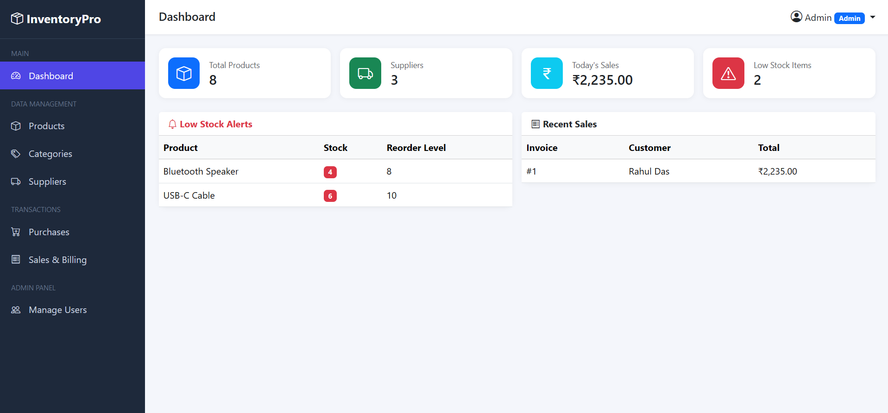
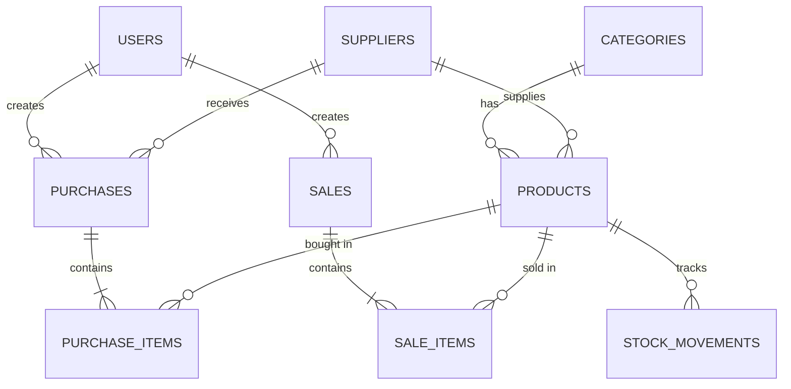
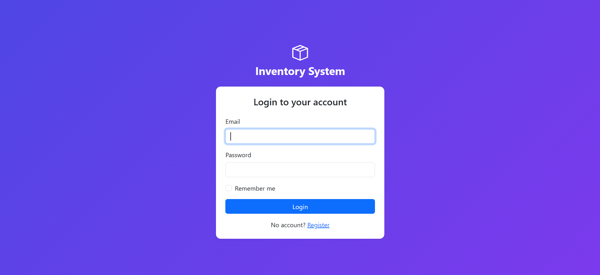
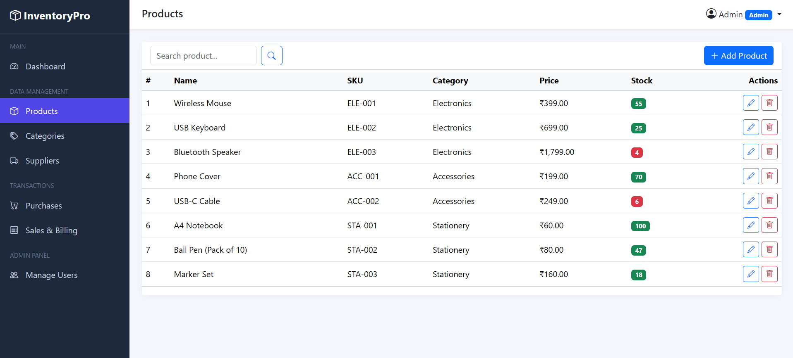
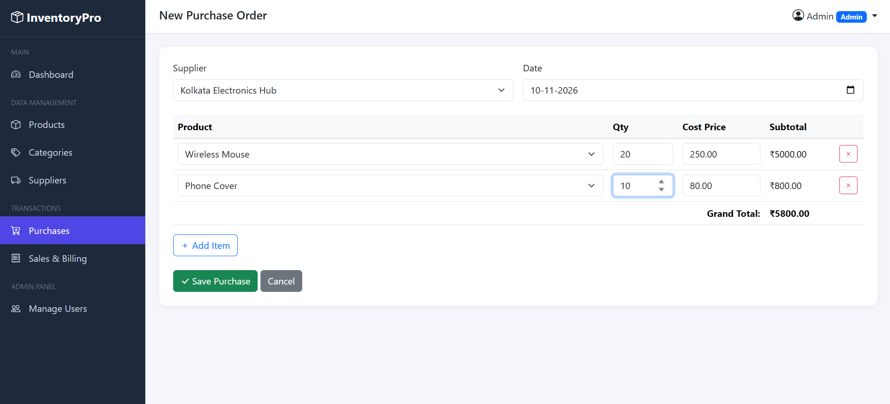
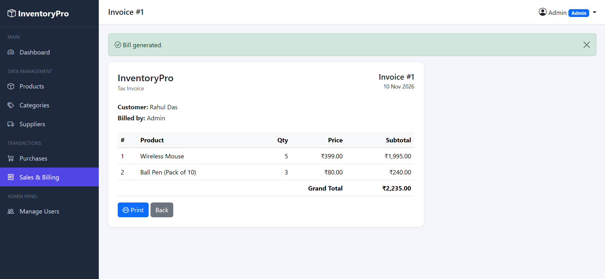
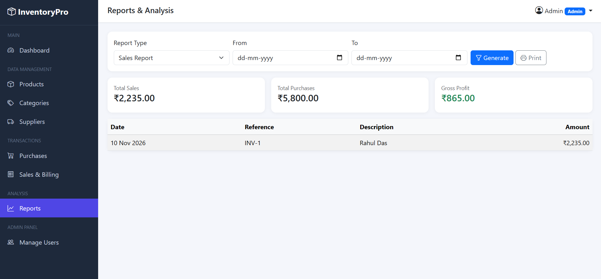

# InventoryPro: Inventory Management System

A web-based inventory management system built with **Laravel 12** and **MySQL**. It manages products, categories and suppliers, records purchases (stock in) and sales (stock out), generates printable invoices, raises low-stock alerts and produces sales, purchase and gross-profit reports. Access is role-based (admin and staff).



## Features

- **Authentication:** register, login, logout, "remember me"
- **Role-based access:** admins manage users and view reports; staff handle day-to-day operations
- **Products, categories and suppliers:** full CRUD with validation, search and pagination
- **Purchases:** record stock bought from suppliers; stock increases automatically
- **Sales and billing:** multi-item invoices with a printable invoice page; stock decreases automatically
- **Overselling protection:** a sale is refused if there is not enough stock
- **Stock movement history:** every stock change is logged (opening, purchase, sale)
- **Dashboard:** product and supplier counts, today's sales, low-stock alerts, recent sales
- **Reports (admin only):** sales, purchase and stock reports with date filters, and gross profit

## Tech stack

| Layer | Technology |
|---|---|
| Backend | PHP 8.2+, Laravel 12 |
| Database | MySQL |
| Frontend | Blade templates, Bootstrap 5, Bootstrap Icons, vanilla JavaScript |

## Technical highlights

- **Database transactions:** a purchase or sale writes to several tables (header, items, stock, history). Either everything succeeds or everything is rolled back, so stock never goes out of sync.
- **Pessimistic locking:** sales use `lockForUpdate()` inside the transaction, so two cashiers cannot sell the last item at the same time.
- **Atomic stock updates:** `increment()` and `decrement()` run a single SQL `UPDATE`, which avoids lost updates.
- **Server-side calculation:** totals are recomputed on the server and never trusted from the browser.
- **Audit trail:** the `stock_movements` table explains every change in a product's quantity.
- **Security:** CSRF protection, hashed passwords, mass-assignment whitelisting (`$fillable`), session regeneration on login, and custom middleware for role checks.
- **Data integrity and performance:** foreign keys, unique constraints, soft deletes for products, eager loading (no N+1 queries) and database-side aggregates.
- **Idempotent seeders:** safe to run repeatedly.

## Database design



## Screenshots

| Login | Products |
|---|---|
|  |  |

| New purchase | Invoice |
|---|---|
|  |  |

| Reports |
|---|
|  |

## Getting started

**Requirements:** PHP 8.2+, Composer and MySQL (for example via XAMPP). Node.js is not needed. Bootstrap loads from a CDN, so an internet connection is required.

```bash
git clone https://github.com/ankitgupta5579/inventory-management-system.git
cd inventory-management-system
composer install
cp .env.example .env          # Windows: copy .env.example .env
php artisan key:generate
```

Create an empty MySQL database named `inventory_management_system` (for example in phpMyAdmin), check the `DB_*` values in `.env`, then run:

```bash
php artisan migrate --seed
php artisan serve
```

Open <http://localhost:8000>.

### Demo accounts (local demo only)

| Role | Email | Password |
|---|---|---|
| Admin | admin@example.com | password |
| Staff | staff@example.com | password |

> These credentials are for local demos only. Never use them in a real deployment.

### Try this flow

1. Log in as admin.
2. Create a purchase of 20 units of a product. The stock goes up.
3. Create a sale of 5 units. The stock goes down and an invoice is generated.
4. Try to sell more than the available stock. The sale is refused.
5. Open **Reports** and generate a sales report.
6. Log in as staff and confirm that Reports and Manage Users are not accessible.

## Project structure

```
app/
├── Http/Controllers/   # Auth, Dashboard, Product, Category, Supplier, Purchase, Sale, Report, User
├── Http/Middleware/    # AdminMiddleware (role check)
└── Models/             # User, Category, Supplier, Product, Purchase, PurchaseItem, Sale, SaleItem, StockMovement
database/
├── migrations/         # Table definitions
└── seeders/            # Demo users and sample inventory
resources/views/        # Blade templates
routes/web.php          # All routes
```

## Known limitations and future improvements

- Purchases and sales cannot be edited or deleted after saving, and there is no returns flow yet.
- Gross profit uses each product's current purchase price as its cost. Storing the cost on each sale item would make it exact.
- Automated tests are planned (feature tests for the purchase and sale stock logic).

## Author

**Ankit Gupta** · [LinkedIn](https://www.linkedin.com/in/ankit-gupta-b63b9432b) · [GitHub](https://github.com/ankitgupta5579)
